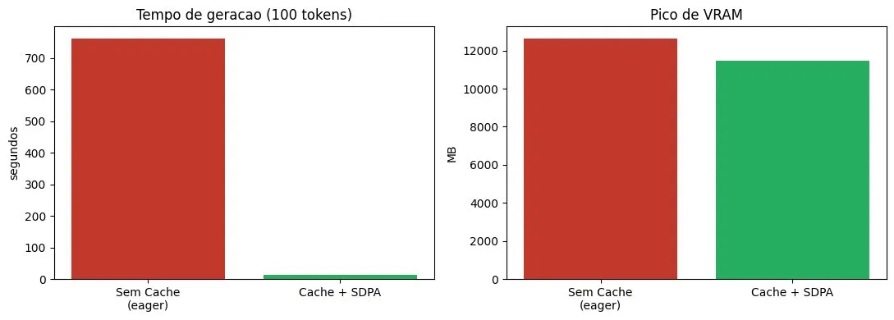

> Partes deste laboratório foram geradas/complementadas com IA, revisadas e validadas por **Aderson Mesquita**.

# Laboratório 10 — O Pipeline Definitivo (RAG, QLoRA e Otimização de Inferência na GPU)

**Aluno:** Aderson Mesquita

Pipeline de inferência ponta a ponta que simula um cenário de produção da **HealthTech**: um
modelo auto-regressivo quantizado por **QLoRA (4-bit)** precisa gerar um resumo clínico a partir
de um contexto massivo (~6.000 tokens) recuperado por RAG. O laboratório demonstra, com medições
reais de VRAM e tempo, como o **KV Cache** e a **atenção eficiente em memória** combatem o erro de
*Out-Of-Memory (OOM)* e a lentidão provocados pela complexidade O(n²) do Self-Attention.

## Justificativa técnica sobre o FlashAttention-2

> O enunciado especifica o uso de **FlashAttention-2** (`attn_implementation="flash_attention_2"`).
> O FlashAttention-2 exige GPU NVIDIA de arquitetura **Ampere ou superior** (A100, L4, RTX 30xx/40xx),
> à qual **não tive acesso** — não possuo GPU NVIDIA local e o ambiente gratuito disponível (Google
> Colab) fornece uma GPU **T4 (arquitetura Turing)**, não suportada pelo FlashAttention-2.
>
> Como substituto direto, utilizei o **PyTorch SDPA** (`attn_implementation="sdpa"`), da mesma
> família de **atenção eficiente em memória / hardware-aware**. Na T4, porém, o SDPA não dispõe dos
> kernels em SRAM do FlashAttention-2, o que limita o ganho de VRAM (ver "Leitura dos resultados").
> A análise conceitual do FlashAttention-2 está no parecer técnico, exatamente como pedido.

## Observação sobre o tamanho do contexto

Por rodar na **T4 (16 GB)**, o contexto foi fixado em **~6.000 tokens** em vez de 10–15 mil. O motivo
é instrutivo: a atenção `eager` do baseline materializa a matriz O(n²) e ainda faz *upcast* do softmax
para float32, dobrando o pico de memória; acima de ~7 mil tokens isso excede os 16 GB e provoca o
*Out-Of-Memory* — que é precisamente o "desastre" descrito no enunciado. Com 6.000 tokens conseguimos
capturar as métricas do baseline sem estourar, e a versão otimizada (KV Cache + SDPA) roda com folga.

## Stack

- `transformers`, `accelerate`
- `bitsandbytes` (quantização QLoRA 4-bit / NF4)
- Modelo: `TinyLlama/TinyLlama-1.1B-Chat-v1.0`
- Atenção otimizada: **PyTorch SDPA** (substituto do FlashAttention-2 — ver justificativa acima)

## Ambiente de execução

Google Colab com GPU **NVIDIA Tesla T4** (gratuita).

## Como executar

1. Abra `Laboratorio_10.ipynb` no Google Colab e selecione o runtime **GPU T4**.
2. Execute todas as células (*Ambiente de execução → Executar tudo*).
3. As métricas e o gráfico (`benchmark.png`) são gerados na célula de resumo.
4. Caso o Passo 3 dê *Out-Of-Memory*: reinicie a sessão e rode desde o início; se persistir, reduza
   `TOKENS_ALVO` para `5000` ou `4000` no Passo 2.

---

## Resultados (Benchmark)

Execução real em **NVIDIA Tesla T4** (Google Colab).

| Métrica | Valor |
|---|---|
| GPU utilizada | Tesla T4 |
| VRAM do modelo quantizado em 4-bit | 727,17 MB |
| Tamanho do contexto RAG | 6.085 tokens |
| **Tempo de geração SEM KV Cache (eager)** | 761,66 s (~12,7 min) |
| **Tempo COM KV Cache + SDPA** | 14,41 s |
| **Pico de VRAM SEM cache (eager, O(n²))** | 12.631,67 MB |
| **Pico de VRAM COM SDPA** | 11.476,14 MB |
| **Speedup (tempo)** | **52,84×** |
| **Redução de VRAM** | **9,15%** |

### Leitura dos resultados

O ganho mais expressivo foi no **tempo**: o KV Cache reduziu a geração de **761,66 s para 14,41 s
(speedup de ~53×)**. Isso acontece porque, sem o cache, cada um dos 100 tokens novos forçava um
*forward* completo sobre os ~6.000 tokens do contexto — recalculando Q, K e V de toda a sequência a
cada passo (recálculo redundante). Com o KV Cache, o contexto é processado **uma única vez** e cada
token seguinte custa praticamente o processamento de uma única posição nova.

Já a **redução de pico de VRAM foi modesta (~9%)**, e isso é esperado *neste hardware*. O pico de
memória é determinado pela fase de *prefill* — o primeiro *forward*, que precisa processar o contexto
inteiro de uma vez **em ambos os casos** (o KV Cache acelera a decodificação, mas não diminui o custo
do prefill). Além disso, na T4 o SDPA não dispõe dos kernels em SRAM do FlashAttention-2 (que exigem
arquitetura Ampere+), oferecendo apenas economia parcial frente à atenção `eager`. **Em uma GPU
Ampere/Ada com FlashAttention-2 de fato, a redução do pico de VRAM seria muito maior**, pois a matriz
O(n²) jamais seria materializada nem mesmo durante o prefill. Ainda assim, foi a QLoRA que permitiu
que o modelo coubesse desde o início (727 MB em vez de vários GB), mantendo o pico de 12,6 GB abaixo
do teto de 14,5 GB da T4 — sem ela, haveria OOM imediato.

---

## Parecer Técnico

### Parte A — Como QLoRA + KV Cache + FlashAttention salvaram o Transformer

A combinação das três técnicas ataca três fontes distintas de pressão sobre a GPU e, somadas,
impedem o colapso do Transformer neste laboratório. A **QLoRA (4-bit)** atua sobre o custo
*estático*: ao quantizar os pesos para 4 bits (NF4) com quantização dupla, o modelo ocupou apenas
727 MB em vez de vários GB em FP16, liberando a maior parte da memória da GPU para o contexto
gigantesco — sem isso o pico de 12,6 GB já teria estourado a T4 de cara. O **KV Cache** ataca o custo
*redundante de tempo*: sem ele, cada novo token gerado força o recálculo das projeções K e V de toda
a sequência já processada, o que neste lab significou 761 s; ao armazenar K e V dos tokens passados,
a decodificação passou a custar essencialmente uma posição nova por passo, derrubando o tempo para
14 s (speedup de ~53×). Por fim, o **FlashAttention-2** — e, na mesma família, a atenção eficiente em
memória (SDPA) usada nesta execução — ataca o custo *quadrático de memória* do próprio Self-Attention:
em vez de escrever a matriz de scores `n × n` inteira na VRAM (HBM), ela é calculada em blocos
(*tiling*) dentro da memória rápida SRAM da GPU, reduzindo o consumo de memória da atenção de O(n²)
para O(n) e acelerando o cálculo por reduzir leituras/escritas em HBM (algoritmo *IO-aware*). Vale
registrar que, na T4 (sem suporte ao FlashAttention-2), o ganho de VRAM observado foi modesto (9%),
pois o SDPA não acessa esses kernels otimizados em SRAM; em hardware Ampere+ com FlashAttention-2, a
matriz O(n²) não seria materializada e a redução de pico de VRAM seria muito maior. Em conjunto, a
QLoRA "esvaziou o terreno", o KV Cache eliminou o retrabalho a cada token e a atenção eficiente em
memória conteve a explosão quadrática — e foi essa soma que transformou um cenário de OOM e lentidão
extrema em uma inferência viável.

### Parte B — Por que mesmo o FlashAttention falharia com 2 milhões de tokens, e por que a indústria migra para SSMs (Mamba)

O FlashAttention-2 resolve a *materialização* da matriz de atenção, mas **não altera a natureza
fundamentalmente quadrática do mecanismo**: o número de operações do Self-Attention continua
crescendo como O(n²), de modo que a latência do *prefill* para 2 milhões de tokens seria proibitiva
mesmo sem nenhum estouro de memória. Pior ainda, o próprio **KV Cache cresce linearmente** com o
comprimento da sequência — é preciso guardar os tensores K e V de *cada token* em *cada camada*,
de forma que, para milhões de tokens, o cache passa a ocupar dezenas de gigabytes e volta a estourar
a VRAM por conta própria, agora independentemente do FlashAttention. Em outras palavras, o
FlashAttention adia o problema, mas o gargalo O(n²) em computação e o crescimento O(n) do cache
permanecem estruturais. É por isso que a indústria tem migrado para os **State Space Models**, como a
arquitetura **Mamba**: em vez de comparar cada token com todos os outros, eles comprimem todo o
passado em um **estado recorrente de tamanho fixo**, o que dá complexidade de memória **O(1)** por
passo de inferência (o estado não cresce com o comprimento da sequência) e custo computacional
**linear O(n)** para processar a sequência inteira. O mecanismo seletivo do Mamba ainda permite que
o modelo decida o que reter ou descartar do estado, viabilizando contextos de milhões de tokens que
seriam economicamente e fisicamente inviáveis para qualquer Transformer, por mais otimizada que seja
sua implementação de atenção.

---

## Versionamento

Versão final entregue na *tag* / *release* **`v1.0`**.
